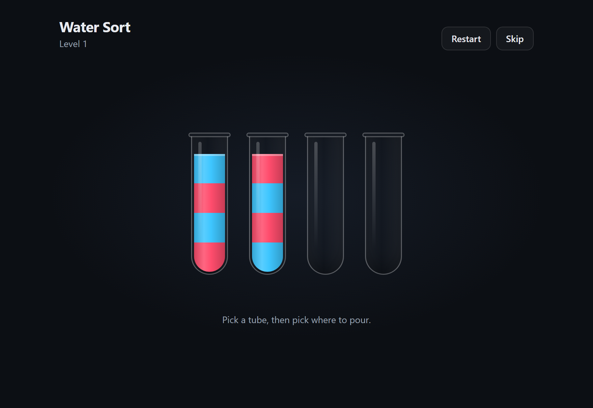

# Water Sort

A small Water Sort puzzle built with React and Vite.



## How to play

- Click a tube to pick it up, then click another tube to pour into it.
- You can only pour onto the same color, or into an empty tube, and only while there is room.
- The level is solved when every tube holds a single color (or is empty).
- **Restart** resets the current level. **Skip** moves on to the next one.

The first four levels are hand-made. After that, puzzles are generated randomly and checked to be solvable.

## Run locally

```bash
npm install
npm run dev
```

Then open http://localhost:5173.